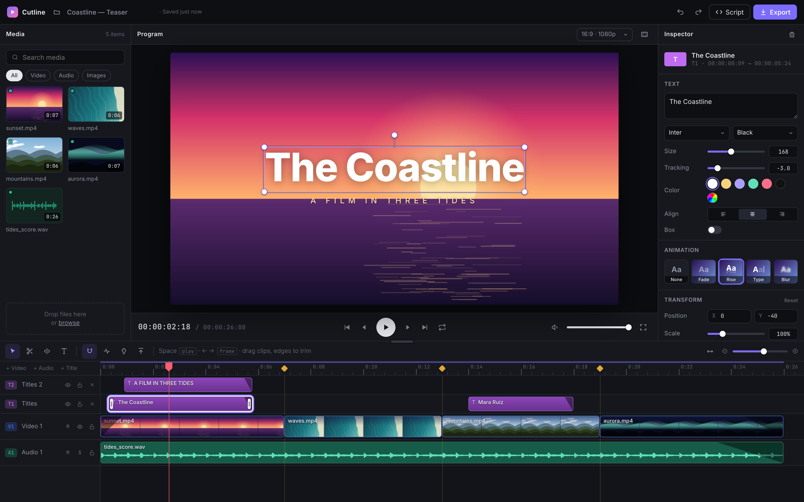
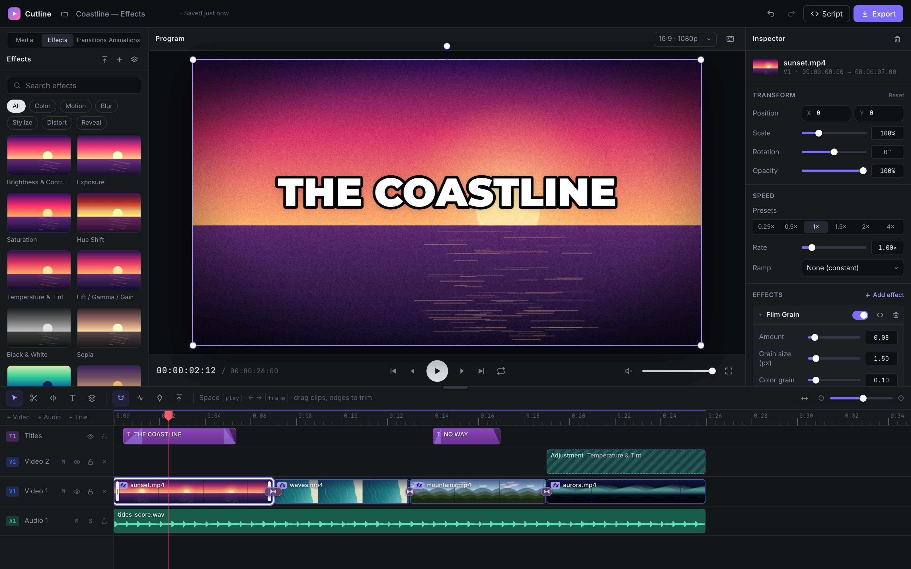
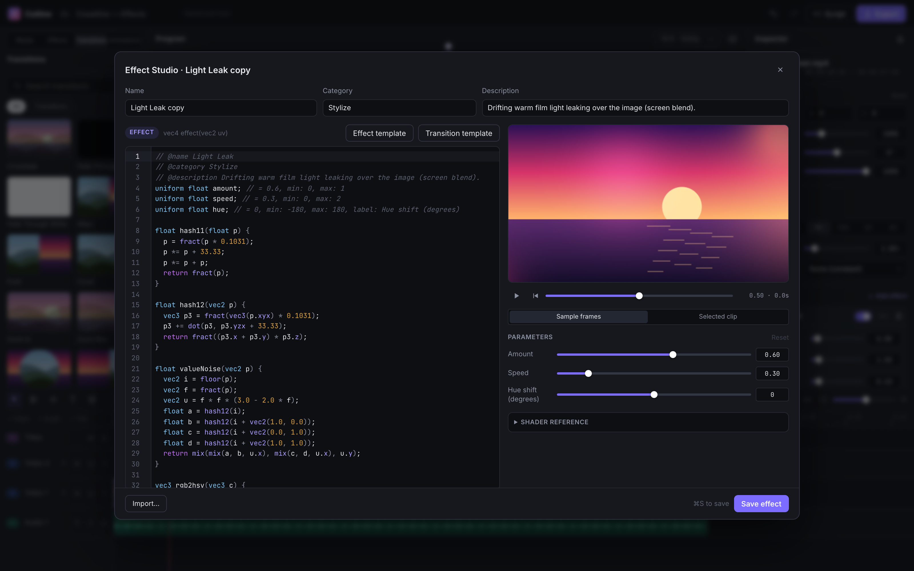
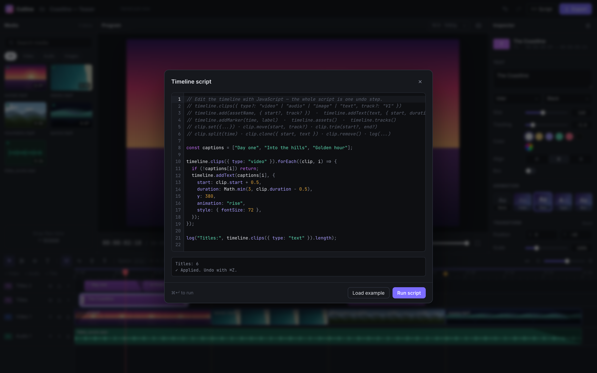

<div align="center">

# Cutline

**A non-linear video editor that runs entirely in your browser.**
Import, cut, title, mix and export to MP4 — no uploads, no server, no install.

Built on [Mediabunny](https://mediabunny.dev/) + WebCodecs · React 19 · StyleX · [Vite+](https://viteplus.dev/)

</div>



## Highlights

- **Everything stays on your device.** Decoding, preview and encoding use
  WebCodecs through Mediabunny. Projects and their media autosave to IndexedDB
  and reopen on reload. Cutline asks the browser to keep that storage and
  checks there is room before copying a file in; media that doesn't fit still
  works until you close the tab, and a notice says it won't survive a reload.
- **Portable projects.** Use **☰ → Save project** to download a `.cutline` bundle
  with the timeline, custom effects and original media. **Open** restores it or
  imports ordinary media files. The [versioned project format](docs/project-format.md)
  keeps sources together without base64 expansion.
- **A quieter workspace.** The header keeps the project name and saved status;
  the menu holds Script, Export, Light/Dark/System themes and keyboard shortcut Help.
- **Style video and image frames.** The inspector's Appearance section adds rounded
  corners, visual corner and border presets, gradients, padding, crop/fit, shape and
  custom polygon masks, inward feathering, inner/outer shadows, glow and blend modes.
  Drag the shadow preview to position it, or enter exact pixel offsets.
  Styling follows the clip's transform, appears in exports and saves with the project.
- **A real multi-track timeline.** Video, audio and title tracks with
  filmstrips and waveforms. You can move clips (across tracks and in groups),
  trim, blade and split, ripple-delete, copy, paste and duplicate. Snapping
  covers edges, markers and the playhead. Tracks can be muted, soloed, hidden
  and locked. Drop a clip over others and it overwrites exactly the space it
  covers. Each clip shows its effect stack as chips (click one to bypass it),
  its in and out animations as bands with their easing curve (drag the edge
  to retime), its loop as a badge, and each transition as a labelled block
  over its cut (drag either edge to resize); right-click any of them for more.
- **What you see is what you export.** The live preview and the export share
  one compositor, and live playback and the export mixdown share one Web Audio
  scheduler. Playback shows exactly the frames the export will write, at the
  project rate, clocked by the audio you hear.
- **Any common frame rate.** 23.976, 24, 25, 29.97, 30, 50, 59.94, 60 and
  120 fps, with drop-frame timecode at 29.97 and 59.94. The first video on an
  empty timeline sets the canvas and frame rate, like "new sequence from clip".
- **Direct manipulation.** In the viewer, move, scale and rotate layers on the
  canvas with snapping to the centre and edges. Right-click anything for a
  context menu.
- **Effects, transitions and animations.** 76 GPU effects and 26 transitions
  built in, including the looks short-form editors lean on: punch-in and
  bouncy zooms, impact shake, flash, glitch, RGB split, light leaks and film
  burn. Stack effects per clip, filter everything below with adjustment
  layers, and give any clip In, Out and Loop animations.
- **Write your own effects.** The Effect Studio compiles GLSL live, with inline
  errors and parameters generated from your shader. You can also import
  gl-transitions shaders, `.cube` LUTs and effect packs.
- **Audio effects.** Voice enhance, EQ, compressor, reverb, echo, bass boost,
  telephone, megaphone, muffled, pitch shift, robot, distortion, tremolo,
  filter, pan and gain. They're heard in playback and baked into the export.
- **Silence removal.** "Remove silences…" on a clip with speech finds its
  pauses (the threshold adapts to the recording), shows them striped on the
  timeline while you tune threshold, minimum pause and padding, then cuts
  them out as jump cuts in one undo step.
- **Auto-captions.** Right-click a clip with speech and choose "Generate
  captions…": Whisper transcribes it on your device (WebGPU, or WASM where
  that is missing) and each phrase becomes a timed title on a Captions track
  in any caption look, with karaoke following every spoken word. The speech
  model downloads once and is cached; no audio leaves the browser.
- **Captions and titles.** Type straight onto the monitor: double-click a
  title (or press `Enter`) to edit it in place. Eight bundled fonts with
  weight, tracking, colour, a box and an outline, plus text looks: adjustable drop shadow, neon glow,
  gradient fill, line or word highlight box and a sweeping shine. Per-letter,
  per-word or per-line animation (pop, slide, bounce, typewriter, wave, jiggle
  and more, with stagger and easing), karaoke word highlighting, and one-click
  Bold, Hormozi, Karaoke, Gaming, Neon and Gradient caption looks.
- **Clip controls.** Transform, opacity, volume up to 200%, speed from 0.1× to
  8×, velocity speed ramps, freeze frames (`F`) and fade in/out.
- **Export** to MP4 (H.264/AAC) or WebM (VP9/Opus) at any resolution. You get
  progress with an ETA, cancel, and an in-app preview, and the export can keep
  running in the background. In Chrome and Edge you pick where to save first
  and the video streams straight into that file as it encodes, so its length
  is bounded by your disk, not memory; other browsers build it in memory and
  offer a download.
- **Scriptable.** Edit the timeline with JavaScript in a syntax-highlighted
  editor with API autocompletion. A whole script is one undo step.
- **Marker import** from chapter lists, CSV/TSV, SRT/WebVTT subtitles and
  LiveSplit `.lss` splits.

## Effects, transitions and animations



The choice of built-ins comes from looking at what popular editing styles rely
on: MrBeast/Hormozi-style YouTube, CapCut "velocity" edits and stream/podcast
clippers. Snappy zooms, flash and glitch cuts, impact shakes, speed ramps,
freeze-and-zoom and bold outlined captions come up again and again.

| Kind             | Built in                                                                                                                                                                                                                            |
| ---------------- | ----------------------------------------------------------------------------------------------------------------------------------------------------------------------------------------------------------------------------------- |
| Color (14)       | Brightness/contrast, exposure, saturation + vibrance, hue, temperature/tint, lift/gamma/gain, B&W, sepia, invert, duotone, posterize, threshold, fade, colour isolate                                                               |
| Motion (4)       | Punch zoom (snap, bounce, slow push), zoom pulse, impact shake, Ken Burns                                                                                                                                                           |
| Blur (5)         | Gaussian, zoom, motion, tilt-shift, sharpen                                                                                                                                                                                         |
| Stylize (20)     | Vignette, grain, chromatic aberration, glow, pixelate, halftone, edges, emboss, toon, CRT, VHS, glitch, old film, night vision, thermal, kaleidoscope, letterbox, dither, light leak, flash                                         |
| Distort (7)      | Bulge, swirl, wave, ripple, mirror, shake, lens                                                                                                                                                                                     |
| Transitions (26) | Crossfade, fade through black/white, wipe, push, cover, zoom, zoom punch, zoom blur, iris, clock, diamond, dissolve, pixelate, whip, glitch, RGB split, flash, light leak, film burn, spin, ripple, swirl, luma wipe, doorway, cube |
| Animations       | **In/Out:** fade, slides, zoom in/out, pop, spin, drop, rise, elastic, bounce, shake, flicker, plus wipe/iris/blur/pixelate/glitch/dissolve reveals. **Loop:** pulse, breathe, float, wiggle, heartbeat, sway, spin                 |
| Speed ramps      | Velocity, montage, hero time, bullet, jump cut, flash in/out                                                                                                                                                                        |

- **Adding them:** drag an effect onto a clip, or a transition onto a cut,
  from the library panel. You can also double-click a tile or use the
  inspector.
- **Where transitions live:** a transition belongs to the cut. It only plays
  while the two clips touch, extends each clip half its duration past the
  cut, and holds on the edge frame when there's no extra footage.
- **Adjustment layers** filter everything composited below them.

## Write your own effects



Effects and transitions are GLSL ES 3.00 fragments. Your code is compiled
inside a host that provides the inputs and clocks:

```glsl
// @name Soft Glow
// @category Light
uniform float amount;  // = 0.6, min: 0, max: 2, label: Glow amount
uniform vec3 tint;     // = vec3(1.0, 0.8, 0.6)   → colour picker

vec4 effect(vec2 uv) {             // transitions: vec4 transition(vec2 uv)
  vec4 c = getColor(uv);           // getFromColor / getToColor for transitions
  return vec4(c.rgb + amount * 0.2 * tint * progress, c.a);
}
```

The host provides `progress` (0 → 1 across the clip or transition), `time`
(seconds), `ratio`, `resolution` and `applyLut(rgb)`. Every `uniform` with a
`// = default` comment becomes a slider, toggle, colour or vector in the UI.

You can import, by dragging onto the window or through the library's Import
button:

| File                      | Becomes                                                                                    |
| ------------------------- | ------------------------------------------------------------------------------------------ |
| `.glsl` / `.frag` / `.fs` | An effect or transition. [gl-transitions](https://gl-transitions.com) files work unchanged |
| `.cube`                   | A colour-grading LUT effect with an intensity control                                      |
| `.json`                   | An effect pack exported from Cutline (parameters are re-derived from the source)           |

Imported and custom effects must compile before they're added, and they're
saved inside the project.

## Quick start

Requires Node 22+ and the [Vite+](https://viteplus.dev/) CLI (`vp`).

```bash
vp install
vp dev
```

Open the printed URL in a recent Chrome, Edge, Safari or Firefox (WebCodecs is
required). Drop some video, audio or images onto the window and drag them onto
the timeline.

| Command    | What it does                                 |
| ---------- | -------------------------------------------- |
| `vp dev`   | Start the dev server                         |
| `vp check` | Format (Oxfmt), lint (Oxlint) and type-check |
| `vp test`  | Run the unit tests (Vitest)                  |
| `vp build` | Production build                             |

A pre-commit hook runs `vp check --fix` on staged files.

Add `?perf` to the URL for a live playback overlay on the monitor: composites
per second, render time, video lag behind the playhead, seeks and dropped
frames.

`bench/long-media.mjs` measures long and large media in headless Chromium
(Playwright drives the dev server's own modules). It generates hour-long
low-resolution videos and a 1.5 GB high-bitrate one in the page (cached in a
throwaway profile under `node_modules/.cache`), then records peak JS heap,
peak renderer memory and whether the tab survived for import, playback start,
export (with the frame and audio counts read back from the file) and
`.cutline` save/open:

```bash
vp dev --port 5199
node bench/long-media.mjs --minutes 10,30,60 --large --out bench/results/run.json
```

## Long and large media

Nothing in Cutline holds a whole file or a whole export in memory: video and
sound are decoded in streams, exports in Chrome and Edge are written straight
to disk, and source files are disk-backed Blobs. Peak renderer memory measured
with `bench/long-media.mjs` in headless Chromium (256×144 15 fps H.264 with
stereo AAC; the large file is 5 minutes of 720p noise at 40 Mb/s, 1.4 GB):

| Media        | Import (before → after) | Export          | Open `.cutline` |
| ------------ | ----------------------- | --------------- | --------------- |
| 10 min       | 832 MB → 424 MB         | 899 MB → 518 MB | 1.3 GB → 466 MB |
| 30 min       | 1.7 GB → 443 MB         | 1.8 GB → 466 MB | 2.5 GB → 518 MB |
| 60 min       | 2.0 GB → 471 MB         | 2.8 GB → 543 MB | 3.9 GB → 545 MB |
| 90 min       | 2.6 GB → 489 MB         | 2.7 GB → 598 MB | 4.0 GB → 522 MB |
| 1.4 GB, 720p | 566 MB → 424 MB         | — → 504 MB      | 814 MB → 471 MB |

Every export reads back with exactly `ceil(duration × fps)` frames and the full
audio length. Raw numbers are in `bench/results/`. What still bounds you:

- **Exports without a save picker.** Firefox and Safari have no
  `showSaveFilePicker`, so the export is built in memory and then offered as a
  download: it needs about twice the output size in RAM.
- **Browser storage.** Each imported file, and each file in an opened
  `.cutline`, is copied into IndexedDB so it survives a reload. The copy needs
  free quota (Chrome allows up to about 60% of free disk; Firefox and Safari
  less) and the same disk space again. Files that don't fit still work until
  the tab closes, and a notice says so.
- **Opened projects read from their file.** Media in an opened `.cutline` is
  read straight from that file, so keep it in place while you edit.
- **What still grows with length** is small: the MP4 sample index of the
  export (about 40 MB of JS heap per hour at 30 fps), waveforms (100 peaks a
  second) and the silence envelope (100 levels a second), under 2 MB an hour
  each.

## Keyboard shortcuts

| Action                      | Keys                  |
| --------------------------- | --------------------- |
| Play / pause                | `Space`               |
| Step one frame / one second | `←` `→` / `⇧←` `⇧→`   |
| Freeze frame at playhead    | `F`                   |
| Go to start / end           | `Home` / `End`        |
| Split at playhead           | `S` or `⌘B`           |
| Delete / ripple delete      | `⌫` / `⇧⌫`            |
| Copy / paste / duplicate    | `⌘C` / `⌘V` / `⌘D`    |
| Select / blade tool         | `V` / `B`             |
| Add title / marker          | `T` / `M`             |
| Edit selected title         | `Enter`               |
| Toggle snapping / loop      | `N` / `L`             |
| Zoom timeline               | `+` `−`, or `⌘`+wheel |
| Undo / redo                 | `⌘Z` / `⇧⌘Z`          |

On Windows and Linux, `⌘` is `Ctrl`.

## Timeline scripting

Open the **☰ menu → Script**. The script runs against a draft of the project
using the same operations as the UI. It is applied as one undoable edit; if it
throws, nothing changes.



```js
// Title every video clip from a list
const dates = ["February 12 2022", "April 12 2022"];
timeline.clips({ type: "video" }).forEach((clip, i) => {
  if (dates[i]) timeline.addText(dates[i], { start: clip.start, duration: 3, y: 380 });
});

// Clone an existing overlay with new text
timeline.clips({ type: "text" })[0].clone({ start: 10, text: "Another title" });
```

| API                                                                   | Description                                                    |
| --------------------------------------------------------------------- | -------------------------------------------------------------- |
| `timeline.clips({ type?, track? })`                                   | Clip handles in time order (`video`, `audio`, `image`, `text`) |
| `timeline.add(asset, { start?, track? })`                             | Place a media asset by name or id                              |
| `timeline.addText(text, { start, duration, x, y, style, animation })` | Add a title                                                    |
| `timeline.addMarker(time, label)`                                     | Add a marker                                                   |
| `timeline.assets()` · `timeline.tracks()` · `duration` · `fps`        | Inspect the project                                            |
| `clip.set(patch)` · `move(start, track?)` · `trim(start?, end?)`      | Edit a clip                                                    |
| `clip.split(time)` · `clone(overrides)` · `remove()`                  | Restructure                                                    |
| `log(...values)`                                                      | Print to the script console                                    |

## Marker import

Use the upload button in the timeline toolbar. Each line or cue becomes a
labelled marker:

| Format             | Example                                              |
| ------------------ | ---------------------------------------------------- |
| Chapter list       | `0:00 Intro` · `1:30 - The climb` · `[12:04] Summit` |
| CSV / TSV          | `time,label` followed by `10.5,"Goal, finally"`      |
| SRT / WebVTT       | Each cue's start time and text                       |
| LiveSplit (`.lss`) | Each segment's personal-best split time and name     |

## Architecture

Dependencies point one way, and the core has none:

```text
ui ──► app ──► store ──► core
          └──► engine ──► core
```

| Layer         | Responsibility                                                                                                                                                                                                                                                                                                                                                                                                                                                                                                                         |
| ------------- | -------------------------------------------------------------------------------------------------------------------------------------------------------------------------------------------------------------------------------------------------------------------------------------------------------------------------------------------------------------------------------------------------------------------------------------------------------------------------------------------------------------------------------------- |
| `src/core`    | Pure TypeScript. Holds the project model and every edit (overwrite placement, move, trim, split, ripple, speed, ramps, paste), effect stacks, transitions, In/Out/Loop animations, the audio-effect catalog, shader metadata and `.cube` parsing, versioned migrations, timecode, scripting and annotation parsing. Unit-tested without a browser.                                                                                                                                                                                     |
| `src/effects` | The built-in shader library, written in the same uniform-comment format users import, plus effect lookup.                                                                                                                                                                                                                                                                                                                                                                                                                              |
| `src/engine`  | The Mediabunny and Web API adapter. `MediaLibrary` probes files, holds preview sinks, streams audio through `AudioReader` and makes thumbnails. `FrameStream` serves frames for scrubbing and sequential playback. One compositor serves preview and export: `GpuEffects` runs effect chains, transitions and LUTs on WebGL2, and adjustment layers filter what's below them. One audio scheduler, with each clip's Web Audio effect chain, serves both playback and the mixdown. Also holds the exporter and IndexedDB persistence.   |
| `src/store`   | Zustand stores. The editor store owns the project behind a single `commit()` writer with undo/redo; continuous gestures coalesce into one step.                                                                                                                                                                                                                                                                                                                                                                                        |
| `src/app`     | Commands that combine store and engine: import, the playback loop, keyboard and context-menu actions, session restore and autosave, and the single error-reporting seam.                                                                                                                                                                                                                                                                                                                                                               |
| `src/ui`      | React 19 with the React Compiler, one component per file, styled with StyleX (tokens in `ui/theme/tokens.stylex.ts`). Controls in `ui/controls` share two surfaces (recessed wells, raised plates) and one portalled `Popover` behind menus and dropdowns; its placement and the slider/scrub math are pure, unit-tested helpers. Uses `use()` + Suspense for session restore and codec probing, `useActionState` for export and scripts, `<Activity>` for dialogs that keep their state, and `<ViewTransition>` for animated dialogs. |

Some design choices worth knowing:

- **Playback follows the audio clock.** Video frames are pulled to the
  `AudioContext` time, so picture and sound cannot drift.
- **Sound streams, it is never decoded whole.** Playback decodes each clip a
  few seconds ahead and schedules it in one-second buffers. The export mixes
  in 10-second windows, each rendered from slightly earlier so reverb and echo
  tails carry across the joins. Waveforms, silence detection and captions
  read the track chunk by chunk. Memory stays flat however long the media.
- **Frame-accurate scrubbing.** Each visible clip keeps a Mediabunny iterator.
  Small forward moves decode through; big jumps restart it, and the latest
  request wins.
- **Drag previews are the commit.** While you drag, the timeline renders the
  result of the same pure operation that runs on drop.

## Credits

Revived from [vjeux/video-editor](https://github.com/vjeux/video-editor) by
Christopher Chedeau. Media handling by
[Mediabunny](https://mediabunny.dev/). MIT licensed — see
[LICENSE.md](LICENSE.md).
